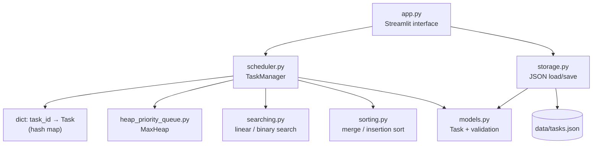
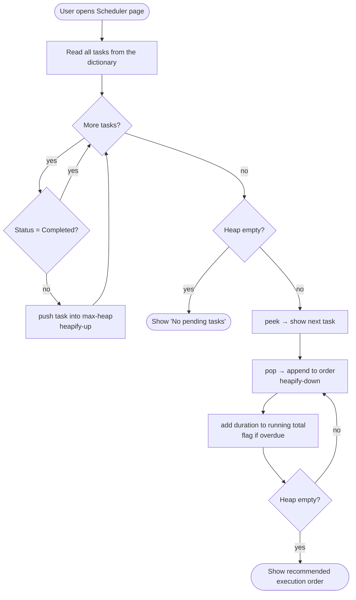

# Smart Task Scheduler Using Data Structures and Algorithms

A local web application (Python + Streamlit) that stores tasks, searches and sorts them, and recommends an execution order using a **binary max-heap priority queue written from scratch**.

---

## 1. Project Title

**Smart Task Scheduler Using Data Structures and Algorithms**

## 2. Abstract

Students and professionals often keep tasks in plain lists that do not tell them what to do next. This project builds a task scheduler that applies core data structures and algorithms to that problem. Tasks are kept in a hash map (Python dictionary) keyed by task ID for fast lookup and persisted to a JSON file. A custom binary max-heap acts as a priority queue that orders pending tasks by priority, then deadline, then task ID, giving a deterministic recommended execution order. Linear search finds tasks by title, binary search finds tasks by ID on a sorted ID list, and hand-written merge sort and insertion sort sort tasks by deadline, priority and duration. A Streamlit dashboard presents statistics, overdue and upcoming tasks, the schedule, a view of the heap's internal array, and a complexity-analysis section. The project is verified with an automated `unittest` suite.

## 3. Problem Statement

Given a set of tasks, each with a priority, an optional deadline and an estimated duration, the user needs to (a) store and manage them reliably, (b) find tasks quickly, (c) view them in different sorted orders and (d) know **which pending task to work on next**. A plain unordered list makes "what next?" an O(n) scan each time and gives no consistent rule for ties.

## 4. Objectives

1. Implement a binary max-heap (insert, peek, extract-max, heapify-up, heapify-down) without using `heapq`.
2. Use the heap as a priority queue with a clearly defined, deterministic ordering rule.
3. Implement linear search and binary search, and show their step counts.
4. Implement merge sort and insertion sort and apply them to real task fields.
5. Use a hash map for O(1) average-case task lookup by ID.
6. Persist data safely in JSON and handle invalid input and broken files.
7. Present everything in a clean dashboard and verify the logic with automated tests.

## 5. Existing System and Proposed System

**Existing system (typical to-do lists / notebooks / spreadsheets)**
- Tasks are stored in insertion order; the user decides manually what to do next.
- No consistent rule when two tasks look equally important.
- Searching means scanning the whole list.
- Overdue tasks are easy to miss.

**Proposed system**
- Pending tasks are placed in a max-heap; the next task is always at the root (O(1) peek).
- Explicit tie-break rule: priority → earlier deadline → lower ID.
- Hash-map lookup by ID, linear search by title, binary search by ID.
- Merge sort / insertion sort for multiple views.
- Dashboard highlights overdue and upcoming tasks; data is saved automatically.

## 6. Hardware and Software Requirements

| Hardware | Minimum |
|---|---|
| Processor | Any dual-core x86-64 / ARM processor |
| RAM | 4 GB |
| Disk | About 300 MB free (Python + Streamlit and its dependencies) |

| Software | Version |
|---|---|
| Operating system | Windows 10/11, macOS or Linux |
| Python | 3.9 or newer (developed and tested on 3.13) |
| Streamlit | 1.37 or newer (`requirements.txt`) |
| Browser | Any modern browser (Chrome, Edge, Firefox) |

No internet connection is needed after installation. No API keys or paid services are used.

## 7. System Architecture



| File | Responsibility |
|---|---|
| `models.py` | `Task` record, allowed values, validation of every field |
| `heap_priority_queue.py` | `MaxHeap` class, `has_higher_priority` rule, `build_task_priority_queue` |
| `searching.py` | `linear_search_by_title`, `binary_search` |
| `sorting.py` | `merge_sort`, `insertion_sort` (stable, key-based) |
| `scheduler.py` | `TaskManager`: add / edit / delete / complete, search, sort, schedule, statistics |
| `storage.py` | Load and save `data/tasks.json` (atomic write, error handling, backup) |
| `sample_data.py` | Eight demo tasks with deadlines relative to today |
| `app.py` | Streamlit pages: Dashboard, Manage Tasks, Search & Sort, Scheduler, Algorithm Analysis |
| `tests/` | `unittest` test suite |

**Folder structure**

```
smart-task-scheduler/
├── app.py
├── models.py
├── heap_priority_queue.py
├── searching.py
├── sorting.py
├── scheduler.py
├── storage.py
├── sample_data.py
├── requirements.txt
├── README.md
├── docs/
│   └── VIVA_PREPARATION.md
├── data/                 (tasks.json is created here on first run)
└── tests/
    ├── __init__.py
    ├── test_models.py
    ├── test_heap.py
    ├── test_searching.py
    ├── test_sorting.py
    ├── test_scheduler.py
    ├── test_storage.py
    └── test_app_smoke.py
```

## 8. Data Structures Used

| Data structure | Where | Why |
|---|---|---|
| **Binary max-heap** (array-based, custom) | `MaxHeap` | Always gives the highest-priority pending task in O(1) (peek) and removes it in O(log n) |
| **Priority queue** | `build_task_priority_queue` | Abstract "always serve the most important first" behaviour, implemented with the heap |
| **Hash map** (Python `dict`) | `TaskManager.tasks` | O(1) average lookup, update and delete by task ID. This is Python's built-in hash table — we did **not** implement hashing or collision handling ourselves |
| **List / dynamic array** | Heap storage, sorted ID list, search results | Index arithmetic for the heap; random access for binary search |
| **Record** (`dataclass`) | `Task` | Groups the fields of a task |

**Task fields:** `task_id` (int, unique, never reused), `title`, `description`, `priority` (1 Low – 4 Critical), `deadline` (date or none), `duration_hours`, `status` (Pending / In Progress / Completed).

## 9. Algorithms and Pseudocode

### 9.1 Scheduling rule (`has_higher_priority(a, b)`)

```
if a.priority ≠ b.priority:        return a.priority > b.priority
da ← a.deadline or +∞ ; db ← b.deadline or +∞
if da ≠ db:                        return da < db
return a.task_id < b.task_id
```
Task IDs are unique, so no two tasks are ever "equal": the order is deterministic.

### 9.2 Heap insert (push) and heapify-up

```
PUSH(item):
    append item at end of array
    i ← last index
    while i > 0 and item comes before array[parent(i)]:   parent(i) = (i−1) // 2
        swap array[i], array[parent(i)]
        i ← parent(i)
```

### 9.3 Heap extract-max (pop) and heapify-down

```
POP():
    if empty: error
    top ← array[0]
    last ← remove last element
    if array not empty:
        array[0] ← last
        i ← 0
        loop:
            best ← i
            if left(i) exists and array[left] comes before array[best]:  best ← left    (2i+1)
            if right(i) exists and array[right] comes before array[best]: best ← right  (2i+2)
            if best = i: stop
            swap array[i], array[best];  i ← best
    return top
```

**How the heap keeps its property:** after a push, only the path from the new leaf to the root can be wrong, and heapify-up fixes that path. After a pop, only the new root can be wrong; heapify-down swaps it with its higher child until both children are lower.

### 9.4 Linear search (title)

```
for each task in tasks:
    if query (lower-case) is inside task.title (lower-case): add task to matches
return matches
```

### 9.5 Binary search (ID)

```
low ← 0 ; high ← n − 1
while low ≤ high:
    mid ← (low + high) // 2
    if ids[mid] = target: return mid
    if ids[mid] < target: low ← mid + 1
    else:                 high ← mid − 1
return −1
```
Binary search needs the IDs **sorted**: only then does "target > middle" prove the target is in the right half. The app sorts IDs with merge sort first. (A dictionary lookup could find an ID in O(1); binary search is used here to demonstrate the algorithm.)

### 9.6 Merge sort (used for deadline and ID)

```
MERGE_SORT(list):
    if length ≤ 1: return list
    left  ← MERGE_SORT(first half)
    right ← MERGE_SORT(second half)
    return MERGE(left, right)       // take from right only if strictly smaller → stable
```
Tasks without a deadline are placed after all tasks with a deadline.

### 9.7 Insertion sort (used for priority and duration)

```
for i from 1 to n−1:
    current ← list[i];  j ← i − 1
    while j ≥ 0 and current comes strictly before list[j]:
        list[j+1] ← list[j];  j ← j − 1
    list[j+1] ← current
```

### 9.8 Scheduling and overdue handling

- Only tasks whose status is **not Completed** are pushed into the heap.
- The heap is **rebuilt from the dictionary every time** a schedule is shown, so an edited, completed or deleted task can never leave a stale copy in the queue.
- **Overdue** = not completed and deadline earlier than today. Overdue tasks stay in the queue (their early deadline already puts them first within their priority level) and are flagged ⚠️. Their priority is **not** raised automatically.
- A task due *today* is not overdue. A task with no deadline is never overdue.
- The "hours done after this task" column is a running total of durations, assuming tasks are done back-to-back. It is an estimate, not a timetable.

> This is a **priority-based recommended order**, not a time-optimal schedule. It does not check whether all deadlines can be met and does not split tasks into time slots.

## 10. Flowchart of the Scheduling Process



## 11. Time and Space Complexity

n = number of tasks, k = number of matches. Auxiliary space excludes the input itself.

| Operation | Function | Time | Auxiliary space |
|---|---|---|---|
| Heap insert | `MaxHeap.push` | O(log n) | O(1) |
| Heap extract-max | `MaxHeap.pop` | O(log n) | O(1) |
| Heap peek | `MaxHeap.peek` | O(1) | O(1) |
| Build schedule (n pushes + n pops) | `recommended_order` | O(n log n) | O(n) |
| Linear search by title | `linear_search_by_title` | O(n) | O(k) |
| Binary search by ID | `binary_search` | O(log n) | O(1) (+ O(log n) step log for display) |
| Merge sort | `merge_sort` | O(n log n) best/avg/worst | O(n) |
| Insertion sort | `insertion_sort` | O(n²) worst/avg, O(n) best | O(1) in-place (our function copies the input first, O(n), so the caller's list is untouched) |
| Dictionary lookup / insert / delete | `get_task`, `add_task`, `delete_task` | O(1) average, O(n) worst | — |

**Assumptions**
- Comparing two tasks is O(1): it compares two integers, two dates and two IDs at most.
- Title search compares strings of at most 100 characters, treated as constant.
- Heap bounds hold because the heap is a complete binary tree of height ⌊log₂ n⌋.
- Dictionary O(1) is an *average*: it assumes Python's hash function spreads keys well.
- In the app, binary search by ID first sorts the IDs (O(n log n)); the O(log n) figure is for the search step itself.

## 12. Installation and Execution (Windows)

1. Install Python 3 from <https://www.python.org/downloads/>. During setup tick **"Add python.exe to PATH"**.
2. Extract the project zip, for example to `C:\Projects\smart-task-scheduler`.
3. Open **Command Prompt** and run:

```bat
cd C:\Projects\smart-task-scheduler
python -m venv venv
venv\Scripts\activate
python -m pip install --upgrade pip
pip install -r requirements.txt
python -m unittest discover -s tests -v
streamlit run app.py
```

The browser opens at <http://localhost:8501>. Stop the app with **Ctrl + C** in the terminal.

Next time you only need:
```bat
cd C:\Projects\smart-task-scheduler
venv\Scripts\activate
streamlit run app.py
```

(macOS/Linux: use `python3` and `source venv/bin/activate`.)

### Troubleshooting

| Problem | Fix |
|---|---|
| `'python' is not recognized` | Reinstall Python with "Add to PATH" ticked, or use `py` instead of `python` |
| `'streamlit' is not recognized` | Activate the venv first, or run `python -m streamlit run app.py` |
| `ModuleNotFoundError: No module named 'streamlit'` | `pip install -r requirements.txt` inside the activated venv |
| `ModuleNotFoundError: No module named 'models'` | Run commands from the project folder (the one containing `app.py`) |
| PowerShell: "running scripts is disabled" when activating | Use Command Prompt, or run `Set-ExecutionPolicy -Scope CurrentUser RemoteSigned` once |
| Port 8501 already in use | `streamlit run app.py --server.port 8502` |
| "The saved task file could not be loaded" | `data/tasks.json` was edited by hand and is invalid. Click the button to back it up as `tasks.broken.json` and reload demo data |
| Want fresh demo data | Sidebar → **Reset demo data** → tick the confirmation → **Reset to demo data** |
| Browser did not open | Open <http://localhost:8501> manually |

## 13. Sample Inputs and Expected Outputs

On first run the app creates eight demo tasks. Deadlines are relative to the day you run it (T = today):

| ID | Title | Priority | Deadline | Hours | Status |
|---|---|---|---|---|---|
| 1 | Submit DSA lab record | 4 Critical | T+1 | 3 | In Progress |
| 2 | Prepare viva notes | 3 High | T+3 | 2 | Pending |
| 3 | Revise binary search | 3 High | T+3 | 1 | Pending |
| 4 | Pay hostel fees | 4 Critical | T−1 | 0.5 | Pending |
| 5 | Read Computer Networks Unit 3 | 2 Medium | T+6 | 2.5 | Pending |
| 6 | Clean up GitHub profile | 1 Low | none | 1.5 | Pending |
| 7 | Team meeting for mini project | 2 Medium | T−2 | 1 | Completed |
| 8 | Practise Java OOP programs | 2 Medium | T+10 | 2 | Pending |

**Expected outputs**

| Input / action | Expected output | Reason |
|---|---|---|
| Dashboard statistics | Total 8, Pending 7, Completed 1, Overdue 1 | Task 7 is late but completed, so it is not overdue |
| Next recommended task | #4 Pay hostel fees | Critical, and its deadline is earlier than #1 |
| Recommended order | 4 → 1 → 2 → 3 → 5 → 8 → 6 | #2 and #3 tie on priority and deadline → lower ID first; #6 has no deadline; #7 excluded |
| Running total of hours | 0.5, 3.5, 5.5, 6.5, 9, 11, 12.5 | Durations added in schedule order |
| Linear search "viva" | Task #2 (8 comparisons) | Every task checked once |
| Binary search ID 5 | Found in 3 steps: (low 0, mid 3, high 7) → (4, 5, 7) → (4, 4, 4) | IDs [1…8] |
| Binary search ID 42 | "No task with ID 42 exists" | Range becomes empty |
| Sort by deadline | 7, 4, 1, 2, 3, 5, 8, 6 | Merge sort; no deadline last; ties keep ID order |
| Mark #4 completed | #4 disappears from the schedule; next task becomes #1 | Completed tasks are not inserted |
| Add task with empty title | Error "Title cannot be empty." and nothing is saved | Validation |

## 14. Testing Strategy and Results

**Strategy**
- **Unit tests** (`unittest`) for each module: model validation, heap operations and heap property under 500 random operations, priority/tie rules independent of insertion order, both search algorithms (found, missing, empty, step trace), both sorts (empty, single, many, stability, descending, random comparison with Python's `sorted()`), TaskManager CRUD, schedule eligibility, stale-entry prevention, overdue/upcoming/statistics, JSON round-trip and broken-file handling.
- **UI smoke test** (`test_app_smoke.py`) uses Streamlit's official `AppTest` to load every page and check for exceptions. It uses a temporary data file and is skipped automatically if Streamlit is not installed.
- **Manual testing** through the interface using the expected outputs in section 13.

**Run:**
```bat
python -m unittest discover -s tests -v
```

**Results recorded during development** (Linux, Python 3.13.17): 56 tests ran, 55 passed, 1 skipped. The skipped test was the UI smoke test, because Streamlit could not be installed in that environment. **Run the command on your own computer after installing Streamlit and record your own output here** — with Streamlit installed, all 56 should run.

## 15. Limitations and Future Enhancements

**Limitations**
- Gives a priority-based order only; it is not a time-optimal or deadline-feasibility scheduler.
- Overdue tasks are flagged but their priority is not changed automatically.
- The heap is rebuilt for every schedule (O(n log n)); fine for hundreds or thousands of tasks.
- Binary search by ID is for demonstration — the dictionary already gives O(1) lookup.
- Uses Python's built-in `dict`, not a hand-written hash table.
- Single user, single computer; the JSON file is not designed for simultaneous editing in two browser tabs.
- No task dependencies, recurring tasks or reminders.

**Future enhancements**
- Earliest-Deadline-First and Shortest-Job-First modes for comparison.
- Deadline feasibility check (cumulative hours vs available hours per day).
- Task dependencies using a graph and topological sort.
- Hand-written hash table with chaining to compare with `dict`.
- Bottom-up O(n) heap construction; indexed heap with decrease-key.
- SQLite storage, user accounts, reminders, calendar export.

## 16. Conclusion

The project shows how classic data structures solve a practical problem. The custom max-heap gives the next task in O(1) and maintains a deterministic order with O(log n) updates; the hash map gives fast access by ID; linear and binary search illustrate the effect of sorted data; and merge sort and insertion sort show the trade-off between guaranteed O(n log n) time and simple in-place sorting. Clear module separation, input validation, safe JSON storage and an automated test suite make the application reliable and easy to explain.

See **`docs/VIVA_PREPARATION.md`** for viva questions, a demo script and a screenshot checklist.
